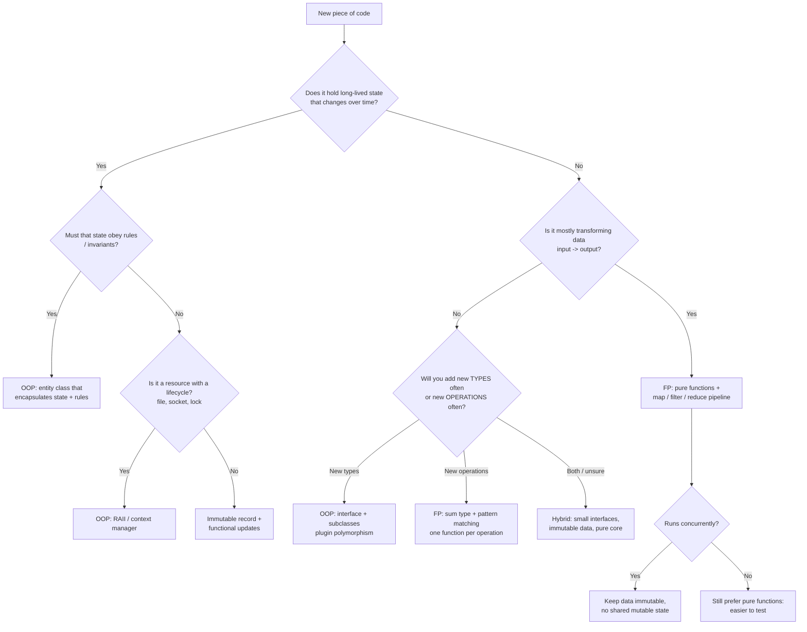

# OOP vs Functional Programming — When to Use Which

> Runnable side-by-side code: [`topics/16_oop_vs_functional`](../topics/16_oop_vs_functional) (Java + C++, with tests).

Object-oriented programming (OOP) and functional programming (FP) are **tools, not teams**.
Modern languages (Java, C++, Python, Kotlin, C#, TypeScript, Rust, Scala) support both, and most
good codebases mix them deliberately.

| | OOP | FP |
|---|---|---|
| Unit of design | objects = state + behaviour | functions over immutable data |
| State | encapsulated and mutated through methods | avoided or made explicit (new values instead of mutation) |
| Polymorphism | subtype (virtual dispatch) | higher-order functions, pattern matching on sum types, type classes |
| Reuse | inheritance, composition | function composition |
| Errors | exceptions | values (`Optional`, `Result`/`Either`) |
| Main risk | hidden shared mutable state, deep hierarchies | over-abstraction, hard-to-read point-free chains, performance surprises |

---

## 1. When OOP shines

1. **Stateful domain entities with invariants** — an `Order`, `BankAccount` or `Reservation` that lives
   a long time, changes over time and must never be invalid. Encapsulation puts the rules next to the data.
2. **Plugin-style polymorphism / open sets of types** — payment providers, file-format exporters,
   game entities, device drivers. Adding a new *type* is one new class; no existing code changes.
3. **GUIs and widget trees** — buttons, windows and views are naturally objects with identity,
   state and event handlers.
4. **Simulations and games** — many interacting agents with their own state (`Car`, `TrafficLight`, `Player`).
5. **Resource management** — files, sockets, locks, GPU buffers: objects with a lifecycle (RAII, context managers).
6. **Frameworks that expect it** — Spring, Django models, Android, Qt, Unity.

## 2. When FP shines

1. **Data transformation pipelines** — ETL, analytics, request → validate → enrich → respond.
   `map` / `filter` / `reduce` and composition read like the spec.
2. **Concurrency and parallelism** — immutable data can be shared across threads without locks;
   pure functions can run in any order.
3. **Pure business rules** — pricing, tax, eligibility, scoring. Inputs in, output out, no hidden state.
4. **Easy testing** — a pure function needs no mocks: call it, compare the result.
5. **Adding many operations over a fixed set of data shapes** — compilers, interpreters, ASTs, reports.
6. **Undo, history, audit, time travel** — state as a fold over events (event sourcing, Redux).

## 3. Decision flowchart



## 4. Hybrid approaches (what most real code does)

- **Functional core, imperative shell** — business rules are pure functions; a thin outer layer of
  objects does I/O (database, HTTP, files). The core is trivially testable, the shell is small.
- **Immutable objects** — objects with methods, but "modifiers" return new instances
  (Java `record` + "wither" methods, `List.copyOf`, `String`, C++ `const` members).
- **Rich domain objects + pure policies** — `Order.pay()` enforces state transitions, but the tax
  calculation it calls is a pure function.
- **Strategy as a function** — inject `Callable[[float], float]` instead of a one-method interface.
- **Event sourcing** — commands handled by objects, state rebuilt by folding events.
- **Sealed/sum types + methods** — algebraic data types that still carry behaviour (Kotlin sealed
  classes, Java sealed interfaces + records, Rust enums with `impl`).

## 5. Key FP concepts explained for OOP developers

| Concept | Meaning | Java | C++ |
|---|---|---|---|
| **Pure function** | same input → same output, no side effects | plain function that touches no globals/I/O | free function taking `const&`, returning a value |
| **Immutability** | values never change after creation | `record`, `List.of`, `String` | `const`, value types |
| **Higher-order function** | takes or returns a function | `map`, `sorted(key=)`, decorators | `std::function`, templates taking lambdas, `<algorithm>` |
| **Lambda / closure** | anonymous function capturing variables | `lambda x: x + n` | `[n](int x){ return x + n; }` |
| **Composition** | build functions from functions | `reduce(lambda acc, f: f(acc), fns, x)` | `std::views::... | ...` pipelines |
| **Streams / lazy pipelines** | process items on demand | generators, `itertools` | C++20 ranges & views |
| **Monad (e.g. Optional/Maybe, Result/Either)** | a wrapper with `map`/`flat_map` to chain steps that may fail or be absent | `Optional.map/flatMap`, sealed `Result` (`Ok`/`Err`) in `OopVsFp.java` | `std::optional::and_then/transform` (C++23), `std::expected` (C++23) |
| **Pattern matching** | branch on the *shape* of data | `match` (3.10+) | `std::visit` on `std::variant` |
| **Recursion / folds** | replace loops that mutate accumulators | `Stream.reduce`, `Collectors` | `std::accumulate`, `std::ranges::fold_left` (C++23) |

### Managing side effects
1. Separate *deciding* from *doing*: a pure function returns **what** to do (e.g. a list of emails to send),
   the shell performs it.
2. Pass effects in as parameters (`clock`, `random`, `repo`) — dependency injection is the OOP
   twin of this idea.
3. Keep mutation local: mutating a local list inside a function that returns a new value is still pure from the outside.
4. Make effects visible in names and types (`save_user`, `-> Result[...]`, `async`).

### The expression problem
- OOP: adding a **type** = 1 new class ✔; adding an **operation** = edit every class ✘.
- FP: adding an **operation** = 1 new function ✔; adding a **type** = edit every function ✘.
Choose based on which axis changes more often. (Visitor pattern = FP-style operations in OOP.)

## 6. Same problem, both ways (excerpt)

**Cart total**
```java
// OOP: a mutable object with methods
var cart = new Cart(); cart.add(new Item("pen", 2.5, 4)); cart.applyDiscount(10); cart.total();

// FP: records + a stream + composed functions
double subtotal = items.stream().mapToDouble(OopVsFp::lineTotal).sum();
double total = discount(10).andThen(x -> Math.round(x * 100) / 100.0).applyAsDouble(subtotal);
```

**Failure handling**
```java
// OOP: exceptions + mutation
processor.place("pen", 2);           // throws OrderException, mutates processor's stock

// FP: a sealed Result, no mutation
switch (placeOrder(stock, "pen", 2)) {               // Ok(new stock map) or Err("out of stock")
    case Ok(var newStock) -> show(newStock);
    case Err(var error)   -> warn(error);
}
```

**Parallel word count**
```java
// OOP: shared counter + ReentrantLock (forget the lock → race condition)
// FP:  nothing shared, nothing locked
Map<String, Long> counts = words.parallelStream()
        .collect(Collectors.groupingByConcurrent(w -> w, Collectors.counting()));
```

See the full code and tests in [`topics/16_oop_vs_functional`](../topics/16_oop_vs_functional).

## 7. Cheat sheet

| Situation | Prefer | Why |
|---|---|---|
| Entity with lifecycle & invariants (Order, Account) | **OOP** | encapsulation protects rules |
| Many interchangeable implementations (plugins, drivers, payment gateways) | **OOP** interfaces | add types without touching callers |
| GUI widgets, game objects, simulations | **OOP** | identity + state + events |
| Resource handles (files, sockets, locks) | **OOP** (RAII / try-with-resources) | deterministic cleanup |
| ETL, data cleaning, reports, analytics | **FP** | pipelines read like the spec |
| Validation chains that can fail at any step | **FP** (`Result` / `Optional`) | no nested try/catch, explicit errors |
| Pricing, tax, scoring, eligibility rules | **FP** pure functions | trivial to test, reuse, cache |
| Multi-threaded / parallel processing | **FP** immutable data | no locks, no races |
| Undo / audit trail / replay | **FP** (fold over events) | history is data |
| Compilers, interpreters, AST transforms | **FP** sum types + match | many operations, stable types |
| One-method interface (Strategy, Command, Callback) | **FP** function / lambda | less boilerplate |
| Configuration / settings objects | **Hybrid**: immutable record | safe sharing, easy updates |
| Web service | **Hybrid**: functional core, OOP shell | testable logic, structured I/O |

### Red flags
- OOP smell: a class with only one method and no state → it's a function.
- OOP smell: `if (x instanceof ...)` chains → missing polymorphism (or use a sum type deliberately).
- FP smell: passing 8 parameters through 6 functions → maybe an object (or a record) is hiding there.
- FP smell: clever one-liners nobody can debug → name intermediate steps.

## Interview questions
1. What makes a function pure? Give an impure example and make it pure.
2. Compare how OOP and FP achieve polymorphism.
3. What is "functional core, imperative shell"?
4. Explain the expression problem and the Visitor pattern.
5. Why does immutability help concurrency? What's its cost?
6. How do `Optional`/`Result` replace exceptions? When are exceptions still better? *Truly exceptional, unrecoverable, or cross-cutting failures.*
7. Is Java/C++ "functional"? *Multi-paradigm: they support FP techniques without enforcing purity.*

## Further reading
- *Functional core, imperative shell* — Gary Bernhardt (Destroy All Software talk "Boundaries").
- *Out of the Tar Pit* — Moseley & Marks (2006), on state as the root of complexity.
- *Domain-Driven Design* — Eric Evans (rich domain models).
- *Domain Modeling Made Functional* — Scott Wlaschin (FP-flavoured domain modelling).
- [Java Stream API (java.util.stream)](https://docs.oracle.com/en/java/javase/25/docs/api/java.base/java/util/stream/package-summary.html)
- [C++ ranges (cppreference)](https://en.cppreference.com/w/cpp/ranges)
